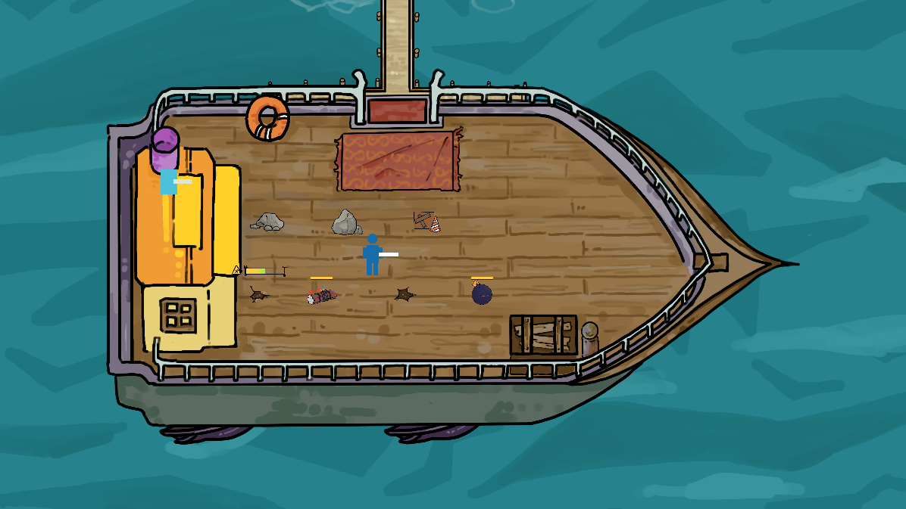

# Ferryman · 摆渡人

在分支群岛之间护送乘客。选择海战、精英、补给、船坞、集市、接驳、宝藏或遗迹岛，积累升级。船只自动航行，你在甲板上射击、清障和修船。第三回从终点港离港时，成功送达的剧情乘客会回来，共同迎战垃圾潮巨像。

## 打开试玩

- **直接游玩（Windows 64 位）**　[下载最新 Windows 试玩包](https://github.com/ZJBIG/Ferryman/releases/download/v0.2-playtest.1/Ferryman-Windows-x64.zip)，解压整个 ZIP，在文件夹里双击 `Ferryman.exe`，无需 Unity。此包包含三日剧情、分支岛屿、成长、NPC 关系和本轮难度调整，请保留 exe 旁的全部文件。
- **开发项目（Unity）**　克隆仓库或从 GitHub 的 `Code → Download ZIP` 下载源码。在 Unity Hub 中添加项目根目录，使用 **Unity 2022.3.62f3c1** 打开，双击 [main 场景](Assets/Ferryman/Scenes/main.unity)，点击顶部 ▶ Play。

## 玩法与操作

从出发岛点击「空船启航」，在海图选择相连的下一座岛。每回经过八座岛、七段海路，未探索的航路为曲虚线，走过后变为曲实线。靠港时可以听乘客讲述出行缘由，再决定接载或谢绝。战斗船员自动射击，维护船员绕障维修。前两回抵达终点港后开始下一回，船况、局内升级和报酬延续至第三回。第三回点击「离港」进入终战，击败巨像后统一结算。

海战从每波三只逐步增加到十二只，每场最多四波；海鸥可在同一波多次带来石块或炸弹。垃圾潮巨像生命为 38,000，三阶段暂缓。关键剧情与上下客交流点击「继续」推进，海路闲聊在航行中播放。同船搭档会改变岗位效率：猴与野猪相互激励，海狸、水獭和犀牛能配合维修，野猪的炮声会干扰水獭，猫头鹰会避开犀牛。

火力、连射、船体强化、快速维修、并行维修、维修范围共有六类成长。岛屿奖励提供最多三选一，集市消费本轮报酬；出发岛永久整备消费已结算金币或特殊道具。局内与永久各最多五级，永久升级在之后的航程继续生效。

| 操作 | 行为 |
| --- | --- |
| WASD / 方向键 | 移动 |
| 移动鼠标 | 瞄准 |
| 按住鼠标左键 | 连续射击 |
| 点击鼠标右键 | 飞踢伤敌、弹开友军，把石块和炸弹踢出船外 |
| 靠近破损处按住 E | 维修 |

每段海路事件前后各自由航行五秒，事件中船只、动画和游戏时间照常推进。炸弹落地后开始引信，爆炸损伤船体并弹开附近友军，不眩晕人物。移动、攻击、眩晕或松开 E 会中断维修，进度保留。异常退出后可从最近检查点恢复选路、奖励和升级；主动放弃或正常关闭丢弃本轮未结算收益。

## 开发与美术接入

- [main 场景](Assets/Ferryman/Scenes/main.unity)是完整航程入口，也是 Build Settings 的首场景。Windows 试玩包通过 `File → Build Settings` 选择 Windows 64 位构建。
- 玩法在 [Scripts](Assets/Ferryman/Scripts)，分支与成长规则见 [群岛策划](Docs/ExpeditionDesign.md)，材质、贴图与挂点见 [美术接入说明](Docs/ArtIntegration.md)，验证范围见 [原型说明](Docs/PrototypeAudit.md)。
- 在 `Window → General → Test Runner` 打开 **PlayMode**，点击 **Run All** 执行回归。
